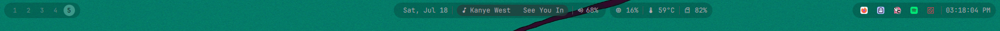
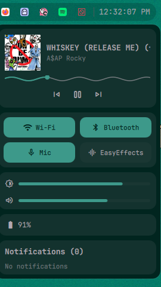
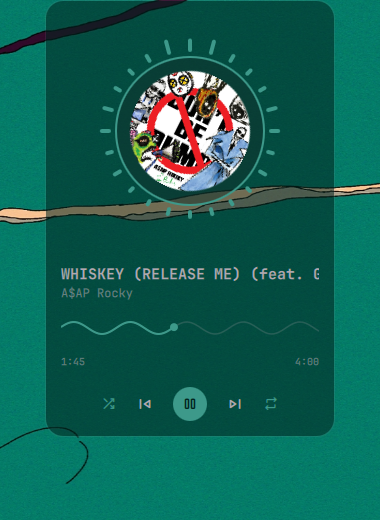
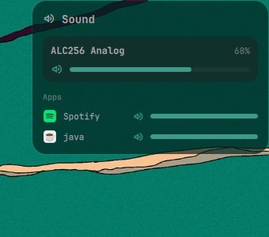
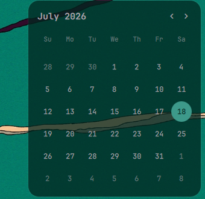
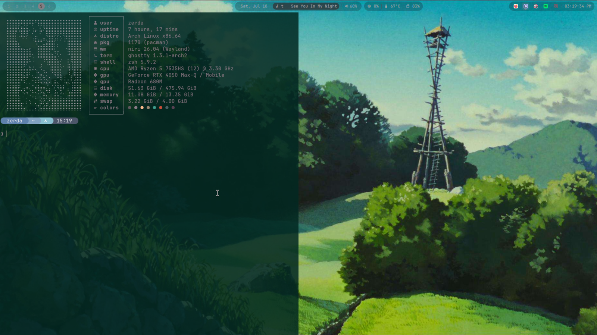
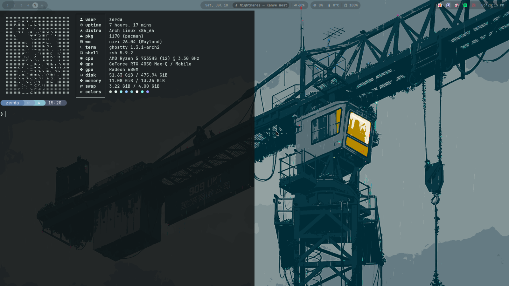

# dotfiles

My personal Arch Linux desktop setup, built around [niri](https://github.com/YaLTeR/niri) (a scrollable-tiling Wayland compositor) and a fully custom [Quickshell](https://quickshell.org/) shell.

Wallpaper-driven theming via [wallust](https://codeberg.org/explosion-mental/wallust) - change the wallpaper and the whole system (terminal, bar, notifications, lock screen, cava visualizer, and more) reskins itself to match.

## Screenshots

<table>
<tr>
<td colspan="2"><br><sub>Status bar - workspaces, taskbar, date/media/volume/weather, system stats, tray, clock</sub></td>
</tr>
<tr>
<td><br><sub>Control center - media, quick toggles, sliders, notifications</sub></td>
<td><br><sub>Media widget - spinning cover art, cava visualizer</sub></td>
</tr>
<tr>
<td><br><sub>Sound mixer - per-app volume control</sub></td>
<td><br><sub>Calendar widget</sub></td>
</tr>
<tr>
<td></td>
<td></td>
</tr>
</table>

Ghostty + fastfetch, with the terminal palette regenerated to match whatever wallpaper is active.

## What's in here

- **Window manager:** niri
- **Shell:** a custom-built Quickshell config - status bar, app launcher, a combined quick-settings/notifications control center, a circular media player with a live cava audio visualizer, a sound mixer, and a calendar, all built from scratch to match this setup rather than using an off-the-shelf bar
- **Terminal:** Ghostty (Kitty/Alacritty also configured)
- **Shell (the other kind):** Zsh, with Starship as the prompt
- **Notifications:** Mako
- **Screen lock:** native QuickShell lock screen (WlSessionLock + PAM)
- **Wallpaper daemon:** awww
- **Theming engine:** wallust, generating color palettes from the current wallpaper and pushing them out to every themed app

## Installing

For Arch and Arch-based distros:

```bash
git clone <this-repo-url> ~/.dotfiles-zerda
cd ~/.dotfiles-zerda
./install.sh
```

Needs a fresh-ish Arch install, an internet connection, sudo, and a few GB free. The script installs packages (official + AUR), symlinks configs into place, sets up Zsh, and systemd services. Takes roughly 15-30 minutes depending on your connection.

## Keybinds

`Mod` is the Super/Windows key.

### Apps

| Keybind | Action |
| --- | --- |
| `Mod + Return` | Terminal (Ghostty) |
| `Mod + B` | Browser |
| `Mod + A` | App launcher |
| `Mod + E` | File manager |
| `Mod + W` | Wallpaper selector |
| `Mod + Shift + B` | Toggle status bar |
| `Mod + Shift + Q` | Lock screen |
| `Mod + Shift + E` | Power menu |
| `Mod + P` | Color picker |
| `Mod + S` / `Mod + Shift + S` / `Mod + Ctrl + S` | Screenshot (selection / full screen / window) |

### Media

Standard media keys (volume, mic mute, brightness, play/pause/next/prev) all work, including while the screen is locked.

### Window management

| Keybind | Action |
| --- | --- |
| `Mod + H/J/K/L` or arrow keys | Focus window/workspace in that direction |
| `Mod + Shift + H/J/K/L` | Move column/window in that direction |
| `Mod + 1-9` | Switch to workspace 1-9 |
| `Mod + Shift + 1-9` | Move window to workspace 1-9 |
| `Mod + Tab` | Previous workspace |
| `Mod + Escape` | Overview mode |
| `Mod + Q` | Close window |
| `Mod + T` | Toggle floating |
| `Mod + F` | Fullscreen |
| `Mod + M` | Maximize column |
| `Mod + C` / `Mod + Ctrl + C` | Center column / center all columns |

Full list (including monitor management and layout sizing) is in `niri/config.kdl`.
